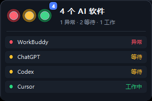

# AI Traffic Light

A tiny, native, always-on-top Windows overlay that shows what your AI tools are doing.

It can watch Cursor, Codex, WorkBuddy, Trae, Windsurf, ChatGPT, and VS Code, then summarize whether agents are working, waiting for input, in error, or idle.

[中文说明](README.md)



## Highlights

- Compact `94 × 50` logical-pixel overlay that expands on hover.
- Aggregates multiple AI apps; red, yellow, and green can be active together.
- Native Rust + Win32 implementation with no Electron or WebView runtime.
- Per-monitor DPI awareness and direct ClearType text rendering.
- Local HTTP API for scripts, hooks, editor extensions, and agents.
- Optional mobile notifications through ntfy, Bark, or a generic webhook.
- Always on top, single instance, position memory, and multi-monitor clamping.

## Status model

| Light | API value | Meaning |
| --- | --- | --- |
| Green | `working` | The AI is generating or executing work |
| Yellow | `waiting` | Human input, approval, or review is required |
| Red | `error` | The task failed or needs attention |
| Off | `idle` | No active task |

## Build

Requirements: Windows 10/11 and the stable [Rust toolchain](https://www.rust-lang.org/tools/install).

```powershell
git clone https://github.com/Liu0330/ai-traffic-light.git
cd ai-traffic-light
.\build.ps1
```

The executable is written to `target\release\ai-traffic-light.exe`.

## Local status API

The service listens only on `http://127.0.0.1:17321`.

```powershell
$body = @{
  app    = 'Cursor'
  status = 'working'
  label  = 'Editing code'
  detail = 'Implementing the sign-in page'
  ttl    = 120
} | ConvertTo-Json

Invoke-RestMethod `
  -Uri 'http://127.0.0.1:17321/status' `
  -Method Post `
  -ContentType 'application/json' `
  -Body $body
```

Supported states are `working`, `waiting`, `error`, and `idle`. Query the aggregate and per-app state with:

```powershell
Invoke-RestMethod 'http://127.0.0.1:17321/status'
```

The optional `ttl` is measured in seconds, defaults to 120, and is clamped to `1–86400`.

## Mobile notifications

Run `mobile-notify\setup-mobile.ps1` and choose ntfy, Bark, or a generic webhook. Notifications are disabled until configured. By default, only `waiting` and `error` are sent, with deduplication and cooldown protection.

## Privacy

- The API binds to loopback only.
- Automatic detection reads process names/activity, not source files or conversations.
- Mobile notifications are opt-in and are sent only to the provider you configure.
- Notification configuration may contain a secret URL and must not be committed.

## Contributing

See [CONTRIBUTING.md](CONTRIBUTING.md). Before opening a pull request, run:

```powershell
cargo fmt --check
cargo check
cargo build --release
```

## License

[MIT](LICENSE)

